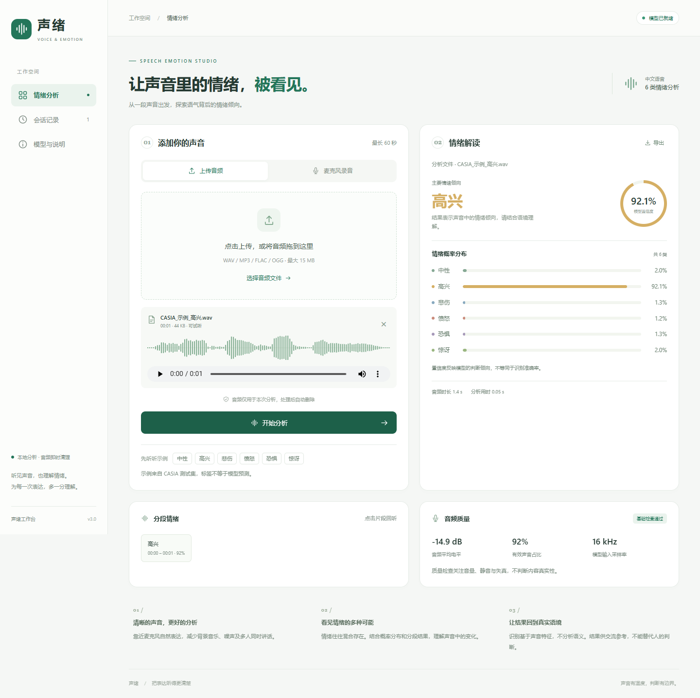

# 声绪 语音情绪识别工作台

基于 **emotion2vec+ large、声学特征融合与双分支概率融合** 的本地语音情绪识别项目。上传音频或使用麦克风录音后，可以查看六类情绪概率、分段分析、音频质量提示与会话记录。

本项目关注声音中的情绪表达，不包含语音转文字或文本情感分析。当前仓库是**可运行的部署版**，配套正式模型和评估记录；历史训练数据、训练脚本与候选缓存已经清理。

[快速开始](#快速开始) · [实现方法](#实现方法) · [评估结果](#评估结果) · [使用方法](#使用方法) · [课程实验报告](docs/课程实验报告.md)

## 项目功能

- 识别中性、高兴、悲伤、愤怒、恐惧、惊讶六类声音情绪。
- 支持拖放上传、文件选择及浏览器麦克风录音，浏览器录音转换为单声道16 kHz WAV。
- 展示整体概率、前三个候选、低置信度提示、波形及按时间分段的识别结果。
- 提供试听、分段回听、最近10次会话记录和JSON导出；刷新页面后会话记录清空。
- 检查静音、过短音频、音量、削波和有效声音比例，给出具体错误或质量提示。
- 提供模型状态、示例音频、各语料实测指标及FastAPI交互文档。

支持WAV、MP3、FLAC、OGG，时长 **0.5–60秒**，文件最大 **15 MB**。建议输入单人、自然、清晰的3–10秒语音，减少音乐和多人同时讲话。

## 实现方法

### 处理流程

~~~mermaid
flowchart TD
    A[上传文件或麦克风录音] --> B[解码 检查质量 转单声道16kHz]
    B --> C[分段 幅值归一化 静音边界裁剪]
    C --> D[共享计算103项声学特征与88项eGeMAPS]
    C --> E[冻结的emotion2vec骨干]
    C --> F[末端四层微调的独立骨干]
    D --> G[冻结分支4287维特征]
    E --> G
    D --> H[微调分支4287维特征]
    F --> H
    G --> I[两个分类头平均logits 温度校准]
    H --> J[单分类头 温度校准]
    I --> K[各分支按有效音频时长汇总]
    J --> K
    K --> L[两个分支概率各占50%]
    L --> M[整体情绪 分段概率 质量反馈]
~~~

### 特征与分类器

每段音频分别经过两个独立的语音骨干。每个分支的特征为：

| 特征 | 维度 |
|---|---:|
| 最终层1024维帧表征的均值与标准差 | 2048 |
| 103项声学统计和88项eGeMAPSv02函数级特征 | 191 |
| 索引5的中间层帧表征均值与标准差，层索引从0开始 | 2048 |
| 合计 | **4287** |

分类器将最终层的2048维统计映射到256维，将其余2239维补充特征映射到64维，拼接后经过128维隐藏层输出六类logits。网络使用LayerNorm、GELU与Dropout。

冻结分支包含两个分类头，先平均logits再进行温度校准；微调分支包含一个分类头，并加载末端四层的微调参数。最终按50%和50%融合两个分支的概率。

长度不超过8秒的音频整体处理；更长音频按约6秒切分，不足1秒的末尾余段合并到前段。整体结果按裁剪后的有效采样点数加权。两个分支只共享同一次请求的确定性预处理，**不共享骨干输出**，缓存也不会保留到下一次请求。

### 技术栈与代码入口

| 部分 | 技术或文件 |
|---|---|
| 网页 | 原生HTML、CSS、JavaScript，Web Audio API |
| 接口与生命周期 | FastAPI、Uvicorn，api/main.py |
| 解码与重采样 | SoundFile、SciPy，src/audio.py |
| 语音模型与分类器 | FunASR、PyTorch，src/inference.py、src/model.py |
| 声学描述 | librosa、openSMILE，src/rich_features.py |
| 标准化 | scikit-learn StandardScaler，joblib保存 |
| 验证 | pytest、固定公开音频一致性检查、可选浏览器检查 |

## 快速开始

### 已准备好当前工程和环境

在项目根目录打开PowerShell：

~~~powershell
.\start.ps1
# 或
.\.venv-ser\Scripts\python.exe run.py
~~~

浏览器访问：

- 工作台：http://127.0.0.1:8000
- 模型状态：http://127.0.0.1:8000/health
- 接口文档：http://127.0.0.1:8000/docs

等待页面显示“模型已就绪”后即可分析，加载时间取决于机器和权重读取速度。默认只监听本机，按Ctrl+C停止前台服务；使用其他端口：

~~~powershell
.\start.ps1 -Port 8001
~~~

如果PowerShell限制脚本执行，直接使用上面的Python命令即可，无需更改全局执行策略。

### 在另一台电脑重新安装

以下以Windows和**64位Python 3.11**为例。先安装[Git LFS](https://git-lfs.com/)，再克隆仓库；正式模型通过Git LFS一并下载，约0.20 GiB。

~~~powershell
git lfs install
git clone https://github.com/willinger566/voice-main.git
cd voice-main
git lfs pull
~~~

如果使用GitHub网页的“Download ZIP”下载代码，请改用上述方式克隆，以确保获得真实模型文件。创建环境时不要启用system-site-packages，后续安装均显式使用项目解释器。

~~~powershell
py -3.11 -m venv .venv-ser
~~~

如果没有安装py启动器，可以将py -3.11替换为可用Python3.11解释器的完整路径。

选择一种PyTorch构建，torch与torchaudio版本必须匹配：

~~~powershell
# NVIDIA CUDA12.8示例
.\.venv-ser\Scripts\python.exe -m pip install torch==2.8.0 torchaudio==2.8.0 --index-url https://download.pytorch.org/whl/cu128

# CPU机器使用这一条代替上面一条
# .\.venv-ser\Scripts\python.exe -m pip install torch==2.8.0 torchaudio==2.8.0 --index-url https://download.pytorch.org/whl/cpu
~~~

构建选择参考[PyTorch官方安装说明](https://pytorch.org/get-started/previous-versions/)。本机实测使用的是Python3.11.14、RTX5070Ti、torch2.11开发版与CUDA12.8；精确版本记录见[运行依赖清单](results/runtime_environment.lock.txt)。不同硬件或依赖版本的数值和耗时可能有差异。

安装其余依赖并检查：

~~~powershell
.\.venv-ser\Scripts\python.exe -m pip install -r requirements.txt
.\.venv-ser\Scripts\python.exe -m pip check
~~~

### 准备模型文件

运行需要同时具备以下两部分：

1. **预训练语音骨干**：models/emotion2vec_plus_large，包含model.pt、config.yaml、configuration.json、tokens.txt等文件。
2. **本项目训练得到的分类器**：models/production，包含根配置、两个分支的分类头、scaler及微调参数。

预训练骨干缺失时，可联网下载：

~~~powershell
.\.venv-ser\Scripts\python.exe prepare_model.py
~~~

该命令**不能生成本项目的production权重**。本仓库的完整models/production权重通过Git LFS提供；如果这些文件只有几百字节，或内容以version https://git-lfs.github.com/spec/v1开头，说明取得的是指针文件，请在仓库根目录执行git lfs install和git lfs pull。

骨干约1.81 GiB，production约0.20 GiB。尤其不要删除branch_1/backbone_adapter.pth、任一scaler或成员权重，也不要混用不同配置。模型会校验骨干SHA256与模型文件签名。

Git LFS配置见[.gitattributes](.gitattributes)，涵盖正式模型的.pth与.pkl文件。预训练骨干由prepare_model.py单独下载；虚拟环境、骨干下载缓存和运行日志不提交到GitHub。README所用图片已单独放在docs/assets中。

### 当前本机环境的特别说明

本地.venv-ser的安装包独立，但创建它所用的Python和标准库来自cvhw。**不能直接删除cvhw后继续使用这个venv**。换电脑时应重新创建环境，不要复制整个.venv-ser。详细区别和删除条件见[环境说明](ENVIRONMENT.md)。

## 使用方法

### 文件分析

1. 打开工作台，确认服务与模型已就绪。
2. 拖放音频或点击选择文件；也可先选择六个示例之一。
3. 试听并检查选中的文件，再点击“开始分析”。
4. 查看整体情绪、六类概率和候选；长音频可结合分段结果回听。
5. 阅读音量、削波或静音提示；需要保存时点击JSON导出。

### 麦克风录音

切换到录音页签，允许麦克风访问，开始录音后再停止，随后点击分析。浏览器会生成WAV再上传。麦克风需要localhost或HTTPS，请从服务地址打开网页，不要直接双击HTML文件。

### 理解结果

置信度是模型分配的概率，**不等于这次预测一定正确的比例**。最高概率低于0.55，或前两类概率差小于0.15时，页面提示结果不明确。这是启发式提醒，不能识别所有错误。

系统依据声音表征和声学特征判断情绪倾向，不进行心理状态诊断。语义、语境、口音、背景噪声和混合情绪都可能影响结果。

### 命令行与API

~~~powershell
# 单条识别，GPU不可用时将cuda改成cpu
.\.venv-ser\Scripts\python.exe src/inference.py --audio_path your_audio.wav --device cuda --output result.json
# 批量识别
.\.venv-ser\Scripts\python.exe src/inference.py --mode batch --audio_dir audio_folder --device cuda --output batch.json
# HTTP文件上传
curl.exe -X POST http://127.0.0.1:8000/predict -F "file=@your_audio.wav"
~~~

| 接口 | 作用 |
|---|---|
| GET /health | 是否加载成功、当前状态、是否繁忙 |
| GET /info | 类别、限制、模型签名、匹配的实测成绩 |
| GET /samples | 六类示例列表 |
| GET /samples/{id} | 获取指定示例音频 |
| POST /predict | multipart字段file，返回识别结果 |
| POST /predict_stream | 尚未实现，返回501 |

/predict主要返回predicted_emotion、confidence、all_probabilities、candidates、uncertain、audio、segments和processing_ms等字段。上传需要标准Content-Length；普通浏览器和curl文件上传会自动提供。

## 评估结果

以下是已固定的录音库测试或回归成绩，按**原始录音**统计，不按增强视图或长音频片段计数。

| 数据范围 | 测试录音 | 旧模型准确率 | 当前准确率 | 当前宏F1 |
|---|---:|---:|---:|---:|
| CASIA中文 | 180 | 77.22% | 77.22% | 76.75% |
| CSEMOTIONS中文 | 698 | 58.88% | 72.06% | 69.02% |
| RAVDESS英语 | 176 | 69.89% | 81.82% | 80.94% |
| CREMA-D英语五类筛选子集 | 562 | 33.45% | 82.74% | 67.88% |

CASIA没有提升；外部中文提高13.18个百分点。CREMA中性占多数，采用声音听感一致率不低于60%的五类筛选子集，不能与完整六类基准直接比较。

累计整理9843条录音，历史训练/验证/测试分别为6498/1729/1616。CASIA原划分共享四位说话人；另外三套语料按说话人划分。46个训练候选及固定融合对照中，只用训练拟合、验证早停/选型和温度校准。测试已经被历次分析使用，后续成绩应称回归结果；无法完全排除骨干预训练与公开语料重叠。

完整1616条音频推理零失败，180条真实HTTP上传零失败。运行优化后180条预测与置信度保持一致；本机处理时间中位数75→52ms，整批15.38→12.00秒。它们不是所有硬件上的速度保证，也不能证明真实麦克风场景已达到90%。

证据见[完整评估](results/release_report.json)、[运行优化](results/runtime_optimization.json)、[实验与负结果分析](ACCURACY_REPORT.md)。

## 目录结构

~~~text
voice-main/
├─ api/main.py                 同源网页与识别接口
├─ web/                        页面 录音 波形和结果交互
├─ src/
│  ├─ audio.py                 解码 质量检查和分段
│  ├─ rich_features.py         帧统计和声学特征
│  ├─ model.py                 分类器 概率摘要和模型签名
│  └─ inference.py             完整推理与命令行
├─ models/
│  ├─ emotion2vec_plus_large/  预训练骨干
│  └─ production/              正式分支及配套参数
├─ data/samples/               六个网页示例
├─ data/validation/            跨语料验证音频
├─ scripts/                    运行检查与可选浏览器验收
├─ tests/                      精简部署版测试
├─ results/                    数据摘要 评估和来源证据
├─ licenses/                   原始来源说明与许可
├─ docs/                       课程报告与文档图片
├─ prepare_model.py            下载预训练骨干
├─ run.py                      启动服务
└─ start.ps1                   本机启动入口
~~~

训练脚本、完整语料与缓存已清理，**本仓库不能一键重训历史46个候选**。可以复现的是部署运行、接口测试、保存样本的一致性验证；继续训练需要另行准备训练工程与数据。清理清单见[CLEANUP_REPORT.md](CLEANUP_REPORT.md)。

## 检查与常见问题

~~~powershell
# 服务启动后，检查9个固定音频的完整概率是否匹配正式模型
.\.venv-ser\Scripts\python.exe scripts/verify_runtime.py
# 首次执行测试时安装检查工具，再运行部署版15项测试
.\.venv-ser\Scripts\python.exe -m pip install pytest httpx
.\.venv-ser\Scripts\python.exe -m pytest tests -q
# 查看Python 标准库和安装包来源
.\.venv-ser\Scripts\python.exe scripts/inspect_environment.py
~~~

完整桌面/移动端验收可选：安装requirements-dev.txt后运行scripts/browser_smoke.py，Windows下默认使用已安装的Edge。普通网页运行不需要Playwright。

| 情况 | 处理方式 |
|---|---|
| 模型未就绪或503 | 等待加载，检查models目录与服务日志 |
| 端口占用 | 使用--port或-Port更换端口，或停止旧服务 |
| 麦克风无法使用 | 使用localhost/HTTPS，并检查浏览器权限 |
| 413 / 415 / 422 | 分别检查大小、格式、音频时长与有效声音 |
| 429 | 推理当前繁忙，等待后重试 |
| CUDA不可用 | 安装匹配构建，或用DEVICE=cpu启动 |
| 重建后无法启动 | 检查Python3.11、配套torch/torchaudio和完整production权重 |

可选环境变量：DEVICE自动选择CUDA/CPU，EMOTION2VEC_MODEL默认models/emotion2vec_plus_large，CONFIG_PATH默认models/production/model_config.json。相对路径均以项目根目录解释。

在PowerShell显式选择CPU的示例：

~~~powershell
$env:DEVICE = "cpu"
.\start.ps1
~~~

## 隐私 许可与引用

上传音频仅用于本次本地推理，处理后删除临时文件；历史仅存在当前页面内存。首次下载安装模型需要网络，之后识别无需向第三方识别API上传音频。

数据、预训练模型和openSMILE分别受其原许可约束，组合权重不能直接视为纯Apache或MIT商业模型。来源、筛选和原始许可见[DATA_SOURCES.md](DATA_SOURCES.md)与licenses目录。当前仓库未声明统一的源码开源许可证，不应替第三方内容推定额外授权。

主要依据：[emotion2vec论文](https://aclanthology.org/2024.findings-acl.931/)、[官方实现](https://github.com/ddlBoJack/emotion2vec)、[CSEMOTIONS](https://huggingface.co/datasets/ATH-MaaS/CSEMOTIONS)、[RAVDESS](https://zenodo.org/records/1188976)、[CREMA-D](https://github.com/CheyneyComputerScience/CREMA-D)、[openSMILE文档](https://audeering.github.io/opensmile-python/)。

课程提交材料：[实验报告Markdown](docs/课程实验报告.md) · [实验报告Word](docs/语音情绪识别系统课程实验报告.docx)。
