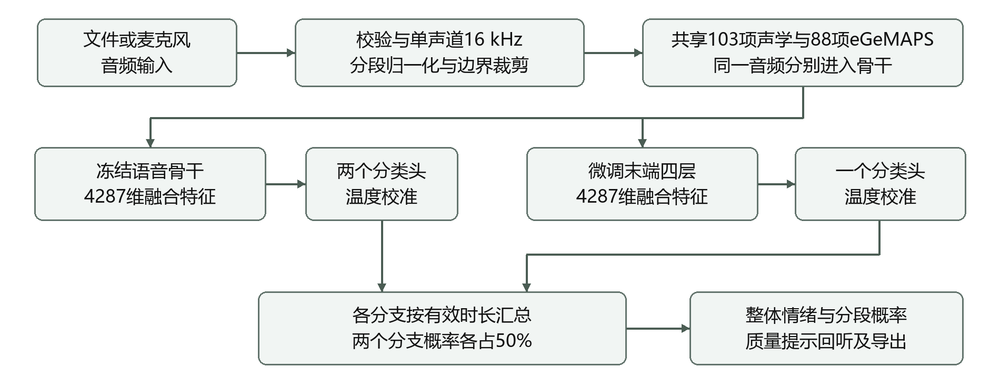
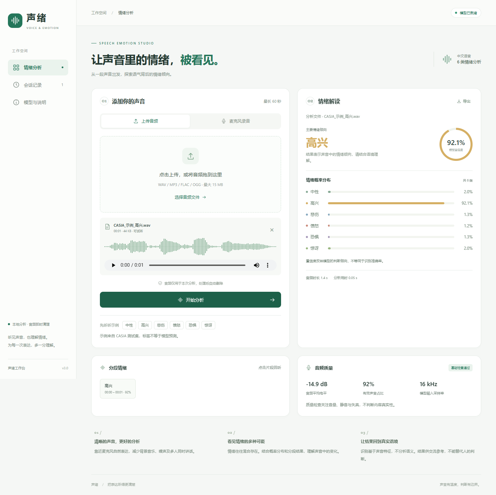

# 基于语音表征与声学特征融合的语音情绪识别系统

课程实验报告

课程名称：____________________________

学生姓名：____________________________

学号：________________________________

专业班级：____________________________

指导教师：____________________________

实验日期：____________________________

系统名称：声绪语音情绪识别工作台

提交版本：ser-v4 部署版

<!-- pagebreak -->

## 摘要

本实验围绕语音情绪识别项目的准确率、交互界面和部署完整性展开改造。系统以emotion2vec+ large为语音骨干，将帧级统计、中间层表征与韵律声学特征组成4287维向量，分别使用冻结分支和末端四层微调分支进行六分类，再融合两者的概率。历史实验共整理9843条原始音频，完成46个训练候选及固定融合对照。正式模型在CSEMOTIONS中文回归集的准确率由58.88%提高到72.06%，CASIA保持77.22%；1616条完整音频推理和180条HTTP上传均无失败。工程实现包括文件上传、麦克风录音、质量检查、分段回听、概率展示和结果导出。本实验同时保留负结果，说明验证成绩、历史回归成绩和真实场景效果之间的区别，未将系统描述为已达到90%的通用识别准确率。

关键词：语音情绪识别；emotion2vec；声学特征；部分层微调；概率融合

## 一 实验目的

实验目标是完成一个从音频输入到模型推理、网页展示和结果验证的可运行系统，并研究预训练语音表征与声学特征结合的方法。具体任务包括检查原项目的问题，补充公开语料，比较冻结表征与部分层微调，构建本地交互界面，并使用与部署一致的完整音频流程评价效果。

原项目改造首先修复推理漏用训练标准化参数、特征模型默认配置不一致和最佳权重保存未独立复制等问题，再补充数据与比较模型。网页增加了真实模型状态、音频质量检查和结果解释，避免将接口可访问等同于模型已经就绪。

评价同时考虑分类性能和工程可靠性。分类性能按语料分别报告准确率与宏F1；工程可靠性检查模型是否真实就绪、输入是否有效、请求是否正确清理，以及不同推理路径的预测是否一致。项目完成度不能仅用最高的一个验证准确率代替。

## 二 实验环境

| 项目 | 本机实际配置 |
|---|---|
| 操作系统与语言 | Windows 64位，Python 3.11.14 |
| 加速设备 | NVIDIA GeForce RTX 5070 Ti |
| 深度学习环境 | PyTorch 2.11.0.dev20260103+cu128，CUDA运行时12.8 |
| 模型与音频工具 | FunASR 1.4.24，librosa 0.11.0，openSMILE 2.6.0 |
| 数值与标准化 | NumPy 1.26.4，SciPy 1.13.1，scikit-learn 1.7.2 |
| 服务与前端 | FastAPI，Uvicorn，原生HTML CSS JavaScript |

训练使用项目目录中的独立venv环境，未在Anaconda base中训练。该venv禁用system-site-packages与用户site，依赖包来自项目环境；但Python解释器和标准库仍由已有cvhw环境提供。二者是“安装包隔离、基础运行时仍有关联”的关系，不能删除cvhw后直接继续使用该venv。精确依赖与路径记录保存在results/runtime_environment.lock.txt及runtime_environment.json。

<!-- pagebreak -->

## 三 数据准备与实验协议

### 数据来源及划分

项目原有CASIA仅包含四位说话人的1200条音频，声音覆盖较少。为比较跨语料的泛化表现，历史训练补充了CSEMOTIONS、RAVDESS和CREMA-D。系统只保留与六个目标类别对应的标签，不将其他情绪强行并入已有类别。数据来源见文献[2]至[4]，具体版本和文件校验记录保存在licenses目录。

| 语料与保留范围 | 训练 | 验证 | 测试 | 合计 |
|---|---:|---:|---:|---:|
| CASIA中文六类 | 840 | 180 | 180 | 1200 |
| CSEMOTIONS中文六类 | 2065 | 776 | 698 | 3539 |
| RAVDESS英语六类语音 | 703 | 176 | 176 | 1055 |
| CREMA-D英语五类筛选子集 | 2890 | 597 | 562 | 4049 |
| 合计 | 6498 | 1729 | 1616 | 9843 |

CASIA保留原有划分，四位说话人在训练、验证、测试中重叠，因此其成绩属于同说话人条件。CSEMOTIONS使用实际字段中的10个说话人ID，训练为female001至003及male001至003，验证为female004和male004，测试为female005和male005。RAVDESS演员01至16、17至20、21至24分别用于训练、验证、测试。CREMA-D分别使用演员1001至1065、1066至1078、1079至1091，外部语料的各集合说话人互斥。

### 标签清洗与去重

CSEMOTIONS原4160条中排除621条playfulness。RAVDESS仅使用音频语音包，排除calm和disgust，并去掉一条训练集内的完全重复音频，保留1055条。

CREMA-D使用原发布者的声音单模态听者多数票，而非仅按文件名中的表演目标赋标签。纳入条件固定为至少6名听者、唯一多数且一致率不低于60%，并排除不支持的disgust类别、并列或低一致率记录、一条重复和一条无法对齐原标注的文件。该语料不含目标类别surprise，最终为五类子集；中性占多数，不能当作完整六类标准基准。[4]

下载时固定仓库版本并校验摘要，合并前检查PCM指纹，未发现跨集合完全重复。切片和增强继承原音频的source_id与划分。仅对CASIA训练音频作轻微重采样、噪声和短混响扰动；验证与测试不增强。切片与增强后共14001行特征，不等于14001条独立原始音频。

### 避免评价泄漏

标准化参数仅使用训练集拟合，早停、候选选择和温度校准只使用验证集。评价按原始音频汇总，避免长音频被切成多段后重复计分。原CASIA测试先前已经公开评价，V3评价过的外部集合在V4中也明确称为历史回归集。新增CREMA测试演员在V4选择完成后才评价；后续分析不得再称其为新盲测。公开预训练骨干是否曾接触这些语料无法完整排除。

<!-- pagebreak -->

## 四 模型原理与特征设计

### 音频预处理

输入首先通过SoundFile解码并检查格式、采样率、声道、时长和有限数值；多声道取均值，再重采样至16 kHz。系统拒绝不足0.5秒、超过60秒、基本静音或有效声音过少的输入，并记录音量、削波比例及有效声音比例。随后进行幅值归一化与20 dB阈值的边界静音裁剪。

不超过8秒的音频整体处理；更长音频按约6秒切分，最后不足1秒的余段并入前段。每段完成相同预处理后送入两个骨干。该设计保留长音频的局部变化，同时限制单段的计算长度。

### 语音与声学特征

emotion2vec是通过自监督学习获得通用情绪表征的方法，相关原理见文献[1]。本项目使用其plus large预训练模型进行迁移，而不是从随机参数开始训练整个语音网络。

每个骨干输出1024维帧表征。最终层和索引5的中间层分别计算均值、标准差，层索引按0起始编号。再拼接103项自定义声学统计与88项eGeMAPSv02函数级特征，形成式（1）。eGeMAPS的维度与配置依据openSMILE官方说明。[5]

$$
x=[\mu(H_{final}),\sigma(H_{final}),a_{103},e_{88},\mu(H_5),\sigma(H_5)]\in\mathbb{R}^{4287} \tag{1}
$$

其中，2048＋103＋88＋2048＝4287。103项统计包含80项MFCC及差分均值/标准差、13项基频/发声/能量统计，以及10项谱形状与过零率统计。它们补充了音高、能量、音色及发声方式信息，但不等同于对情绪因果机制的直接解释。

### 标准化与分类头

各分支使用随模型保存的StandardScaler。推理必须按训练时的均值和缩放值处理输入，不能漏用scaler，见式（2）。

$$
z_j=(x_j-m_j)/s_j \tag{2}
$$

其中m和s仅由训练集拟合并持久化。分类头将最终层的2048维统计映射到256维，将其余2239维补充特征映射到64维，拼接成320维向量，再经过128维隐藏层和六分类输出层。中间采用LayerNorm、GELU及Dropout；补充特征分支同时包含中间层表征与191项声学描述，并非仅输入声学特征。

### 温度校准与概率融合

冻结分支有两个分类头，先平均logits再校准；微调分支有一个分类头。分支概率按式（3）计算，再按式（4）等权融合。

$$
p_k^{(b)}=\frac{\exp(l_k^{(b)}/T_b)}{\sum_{j=1}^{6}\exp(l_j^{(b)}/T_b)} \tag{3}
$$

$$
p_k=0.5p_k^{(frozen)}+0.5p_k^{(tuned)} \tag{4}
$$

当前两个温度分别约为0.9630和1.5432，均由验证集拟合。对长音频，各分支按裁剪后有效采样点数加权汇总概率；再融合分支概率，与按相同权重先逐段融合后汇总等价。

<!-- pagebreak -->

## 五 训练方法与模型选择

### 冻结表征与部分层微调

冻结路线只训练分类头，减少小数据条件下破坏预训练表示的风险。四语料分类头使用来源/类别平衡采样，标准化拟合也采用训练权重。分类头采用AdamW，学习率5×10⁻⁴、权重衰减0.01，批量64、每轮抽样4096次，最多100轮，连续17轮无改善停止；损失使用0.03标签平滑。历史融合分类头对照还使用了轻度特征MixUp。

微调路线保留音频前端及前四个Transformer块，只更新索引4至7的末端四层与分类头。当前正式分支采用骨干学习率1×10⁻⁴、分类头学习率1×10⁻⁴、批量32、每轮4096次抽样、最多20轮和7轮无改善早停，使用FP32及随机种子73。音频骨干可训练参数为50384896。

保存的backbone_adapter.pth是这些末端层更新后的完整参数子集，不是LoRA低秩矩阵。证据记录了梯度检查、冻结层代表参数未变化及选中检查点末层权重最大变化约0.0124424，说明执行了实际微调。为保证训练/推理一致，冻结前缀按未补零的单条音频缓存，再对可训练尾部补齐；四语料特征对齐最大差异小于0.00012。

### 候选范围与选择规则

历史实验共训练46个候选，范围如下。

| 对照方法 | 训练候选数 |
|---|---:|
| 初始帧统计与声学融合分类器 | 16 |
| 最后两层微调 含三次注意力池化 | 4 |
| 原声学与eGeMAPS特征的树模型对照 | 12 |
| 中间层补充特征分类器 | 4 |
| 四语料冻结分类器及最后四层微调 | 4 |
| 悲伤与恐惧SVM校正 | 4 |
| 原始emotion2vec_base分类器 | 2 |
| 合计 | 46 |

这些数量不包含仅改变概率融合比例的验证组合。正式V4的验证综合分为CASIA、CSEMOTIONS、RAVDESS、CREMA宏F1的加权和，权重分别为0.5、0.3、0.1、0.1。CREMA仅对其五个支持类别计算宏F1。选择冻结后再评价完整测试；测试中的退化和负结果均保留。

当前V4验证综合宏F1为0.784544。后续悲伤/恐惧校正的最佳综合收益仅0.000462，且外部中文验证准确率下降，未采用。最后原始base融合虽提高外部中文验证成绩，但CASIA验证仍下降，也未通过事先设定的保留条件。模型选择没有以“训练了更深层”或“某个语料的最高分”作为上线理由。

<!-- pagebreak -->

## 六 系统实现与交互设计

### 前后端与推理链路

系统采用同源部署。FastAPI同时返回网页静态资源和识别接口，避免额外前端构建与跨域配置。前端通过Web Audio API采集、显示波形并生成单声道16 kHz WAV；后端负责解码、质量检查、特征和分类。



图1 系统处理与概率融合流程

模型在后台线程加载，页面区分加载中、就绪与失败。推理使用信号量限制为单个任务，忙碌时返回429，避免两个请求同时修改骨干中间层捕获钩子。上传文件写入临时路径，在成功或异常时均清理。服务只在模型配置、标准化与权重签名匹配时展示对应实测成绩。

### 页面展示

工作台将输入、分析和解释放在同一页面，展示整体情绪、六类概率、前三个候选、低置信度提醒及分段结果。用户可以试听、回听片段、查看最近10条会话记录和导出JSON。会话记录只存于页面内存，刷新后清空。



图2 工作台识别界面

当最高概率低于0.55，或最高两类概率差小于0.15时，系统给出不明确提示。这是启发式规则，不能保证所有错误都会被拒绝，也不能将较高置信度解释为真实正确率。

<!-- pagebreak -->

## 七 运行与使用过程

### 启动当前部署版

在项目根目录打开PowerShell，使用明确的项目解释器启动，避免误用终端默认环境。

```powershell
.\start.ps1
# 或
.\.venv-ser\Scripts\python.exe run.py
```

浏览器访问http://127.0.0.1:8000，等待“模型已就绪”。需要更换端口时执行start.ps1 -Port 8001。麦克风访问要求localhost或HTTPS，不能仅双击HTML文件代替启动服务。

在另一台机器上，应使用完整的64位Python3.11新建venv，安装匹配的PyTorch/torchaudio后，再安装requirements.txt并执行pip check。预训练骨干可通过prepare_model.py下载，本项目训练得到的models/production必须单独完整保留。运行不需要重新训练，但仅有源码不能自动恢复项目自有权重。

### 文件与麦克风操作

选择示例或上传WAV、MP3、FLAC、OGG，试听后点击分析。输入时长限制0.5至60秒，文件最大15 MB。查看概率和质量提示后，可结合长音频分段回听或导出JSON。使用麦克风时先授予权限，录音停止后再提交分析；浏览器会生成WAV文件。

### 接口与验证

| 接口或检查 | 用途 |
|---|---|
| GET /health | 查看加载状态和是否繁忙 |
| GET /info | 获取模型签名 类别与实测成绩 |
| GET /samples | 获取六类示例列表 |
| POST /predict | 通过multipart的file字段上传音频 |
| /docs | 查看FastAPI交互接口文档 |

典型接口返回情绪类别、置信度、六类概率、音频质量、分段结果与处理时间。过大、格式错误、无效音频分别返回413、415、422；未就绪返回503。流式接口尚未实现，返回501。

```powershell
curl.exe -X POST http://127.0.0.1:8000/predict -F "file=@your_audio.wav"
.\.venv-ser\Scripts\python.exe scripts/verify_runtime.py
.\.venv-ser\Scripts\python.exe -m pytest tests -q
```

当前提交版本保留15项部署测试和9个固定公开音频的一致性检查。历史训练脚本、完整语料和缓存已经按部署精简要求清理，因此能直接复现的是启动、识别、接口测试与参考样本校验，不能将其描述为一键重训全部候选的完整训练包。

<!-- pagebreak -->

## 八 评价指标与实验结果

### 评价指标

准确率为正确预测数除以原始音频条数，见式（5）。类别不平衡时，进一步计算各类F1的算术平均，见式（6）。TP、FP、FN分别表示某一类的真正例、假正例和假负例；一般K为6，CREMA五类筛选子集的K为5。

$$
Accuracy=N_{correct}/N \tag{5}
$$

$$
F1_k=2TP_k/(2TP_k+FP_k+FN_k),\quad MacroF1=\frac{1}{K}\sum_{k=1}^{K}F1_k \tag{6}
$$

### 完整音频结果

表中旧模型为本轮开始时部署的V2校准分类器，不是最初漏用scaler的错误流程。对长音频先按有效时长汇总，再给每条原始音频计一次预测。

| 测试或回归范围 | 数量 | 旧准确率 | 当前准确率 | 当前宏F1 |
|---|---:|---:|---:|---:|
| CASIA中文 | 180 | 77.22% | 77.22% | 76.75% |
| CSEMOTIONS中文 | 698 | 58.88% | 72.06% | 69.02% |
| RAVDESS英语 | 176 | 69.89% | 81.82% | 80.94% |
| CREMA-D英语五类筛选 | 562 | 33.45% | 82.74% | 67.88% |

完整1616条音频推理零失败，180条真实HTTP上传零失败。CSEMOTIONS提高13.18个百分点，RAVDESS提高11.93个百分点；CASIA仍正确139条，没有总量提升，其中修正旧错误14条，同时使旧正确样本退化14条。不能仅选修正的样本说明效果提升。

CREMA的总准确率与宏F1差距较大，说明中性占多数时总正确率容易掩盖少数类别表现。其声音听感筛选和五类评分也使它不能与完整六类基准直接比较。当前结果仍不足以证明真实麦克风场景达到90%。

### 结果的适用范围

CASIA测试仅180条且共享说话人，新说话人可靠性不能由此推出。外部语料虽然按说话人隔离，但仍存在标签含义、录音风格和声音分布差异。模型原始预训练来源与本项目外部测试的重叠无法完整核实。因此分别报告各语料成绩，而不将混合后的一个总准确率宣称为中文通用性能。

<!-- pagebreak -->

## 九 追加对照与运行优化

### 不同骨干的互补性

在V4之后，固定训练了两个原始emotion2vec_base分类头，并比较单独使用、与V4各占50%及base占25%的融合。下表均为验证成绩，没有被作为最终网站测试准确率。

| 候选 | CASIA验证 | CSE中文验证 | 综合宏F1 |
|---|---:|---:|---:|
| 已部署V4基线 | 78.33% | 84.54% | 0.784544 |
| base seed42单模型 | 50.56% | 84.41% | 0.632997 |
| base seed42占50% | 76.67% | 90.21% | 0.808413 |
| base seed42占25% | 77.78% | 87.50% | 0.795633 |

外部中文验证确有收益，但未同时满足CASIA严格提高的保留门槛。因而继续使用V4，删除落选权重与缓存，仅保留数值报告和来源记录。这一结果提示不同骨干可能互补，仍需新的独立协议验证；不能通过忽略退化数据集来声称问题已经解决。

### 共享预处理

原融合过程为两个分支重复计算解码、归一化、声学和eGeMAPS特征。改造后只在同一次请求内缓存这些确定性结果，两个骨干仍生成各自的帧表征，避免冻结参数与微调参数互相污染。不同请求之间不共享录音缓存。

| 本机测量项目 | 优化前 | 优化后 |
|---|---:|---:|
| 单条处理时间中位数 | 75 ms | 52 ms |
| 180条HTTP整批耗时 | 15.38 s | 12.00 s |
| 正确数与HTTP失败数 | 139与0 | 139与0 |

180条预测和置信度完全一致，9个包含长音频及跨语料的参考样本完整概率最大差异为0。15项部署测试与pip check通过，浏览器检查覆盖桌面/移动端、WAV录音、推理、历史、导出和模型事实展示。耗时来自本机一次前后测量，不代表所有设备的速度保证。

### 部署精简

在数值记录、许可和正式模型保存后，清理约21.38 GiB训练下载、缓存、落选模型与旧辅助环境。原有数据和初始模型移至独立备份，不作为训练垃圾删除。清理后部署目录约7.27 GiB，主要由5.25 GiB运行依赖和2.01 GiB模型组成。删除训练目录后重新加载服务，参考音频结果仍一致，说明网页不依赖训练缓存。

<!-- pagebreak -->

## 十 错误分析与实验局限

CASIA的41个错误中，24个为悲伤与恐惧相互混淆。外部中文中性召回率为34.21%，恐惧召回率为56.67%，是当前明显短板。两个CSEMOTIONS测试说话人的准确率分别约64.47%和79.66%，说明平均数掩盖了具体声音上的差异；仅凭这两个说话人不能推出群体层面的结论。

置信度也并非可靠的正确保证。CSEMOTIONS中置信度不低于80%的325条样本，仍有34条错误。温度校准和低置信度提示可以帮助解释输出，但没有消除跨数据域的全部过度确信问题。

本实验还存在三项限制。第一，数据规模和自然表达覆盖不足，不同来源的标签定义与风格不完全一致；第二，验证集用于多个固定候选和温度拟合，后续测试又已反复分析，新的泛化结论需要另外保留独立测试；第三，当前模型只依据声音，未利用文本语义或对话上下文，但加入这些信息会改变任务与隐私范围，不能直接沿用原语音指标。

下一阶段应优先收集有授权的目标场景中文音频，由多个听者独立标注，按说话人和会话分组，重新留出未用于选型的测试集。ESD和EmotionTalk需要申请或接受访问条件，本项目没有绕过限制或替用户提交个人信息。数据和openSMILE等工具的许可仍需遵守，清理数据不意味着取消既有使用约束。

## 十一 实验总结

本实验完成了语音输入、特征提取、模型融合、网页交互和完整流程评估。与旧部署模型相比，新增中文与英语语料上的表现提高，但CASIA总准确率没有提高，真实场景90%的目标也未被证实。系统仍实现了可核对的工程改进，包括训练推理标准化一致、实际模型状态、非法输入处理、请求清理及共享预处理提速。

实验结果说明，更大的模型、更多训练轮次或单个更高的验证分数都不足以单独支持上线。应同时检查不同语料、说话人、类别和推理路径，保留退化与负结果，并将实验可复现范围与实际交付内容对应起来。

## 参考文献与实测依据

[1] Ma Z 等. emotion2vec Self-Supervised Pre-Training for Speech Emotion Representation. Findings of ACL, 2024. https://aclanthology.org/2024.findings-acl.931/

[2] ATH-MaaS. CSEMOTIONS数据集及NOTICE. https://huggingface.co/datasets/ATH-MaaS/CSEMOTIONS

[3] Livingstone S R, Russo F A. RAVDESS. PLOS ONE, 2018. DOI 10.1371/journal.pone.0196391. https://zenodo.org/records/1188976

[4] Cao H 等. CREMA-D Crowd-sourced Emotional Multimodal Actors Dataset. IEEE Transactions on Affective Computing, 2014. DOI 10.1109/TAFFC.2014.2336244. https://github.com/CheyneyComputerScience/CREMA-D

[5] audEERING. openSMILE Python Documentation, v2.6.0. https://audeering.github.io/opensmile-python/

[6] 本项目实测记录. results/release_report.json、dataset_report.json、runtime_optimization.json、runtime_verification.json、experiments_summary.json及training_evidence目录。本文数字据这些记录与实际代码整理，不代表在另一台机器上重新完成了全部训练。
